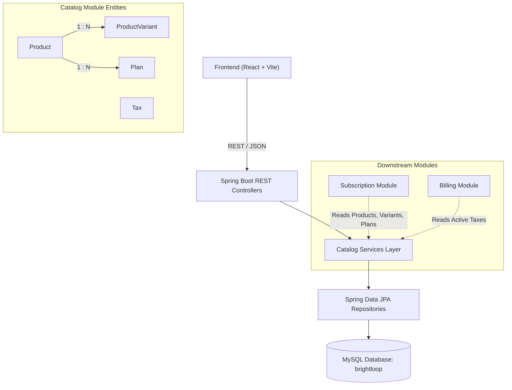

# Brightloop Subscription Management System — Products Module Documentation

## 1. Overview & Architectural Boundaries

The **Products Module** provides product catalog management, item variants, pricing configurations, multi-frequency recurring subscription plans, and sales tax configurations for the Brightloop Subscription Management System.

- **Backend Package**: `com.brightloop.catalog` (subpackages: `product`, `variant`, `plan`, `tax`)
- **Database**: MySQL (`brightloop`)
- **Frontend**: React + Vite SPA
- **Integration Role**: Serves catalog metadata to the **Subscription Module** (quotations and customer contracts) and configured tax rates to the **Billing Module** (invoicing).



---

## 2. Database Schema (`database/schema.sql`)

Four normalized tables were established in the `brightloop` database:

### 2.1 Table: `products`
| Column | Type | Constraints / Defaults | Description |
|---|---|---|---|
| `id` | `BIGINT` | `AUTO_INCREMENT`, `PRIMARY KEY` | Unique product identifier |
| `name` | `VARCHAR(255)` | `NOT NULL` | Product display name |
| `type` | `ENUM('DIGITAL', 'GOODS', 'SERVICE')` | `NOT NULL` | Product classification |
| `sales_price` | `DECIMAL(12, 2)` | `NOT NULL`, `DEFAULT 0.00` | Base selling price |
| `cost_price` | `DECIMAL(12, 2)` | `NOT NULL`, `DEFAULT 0.00` | Internal cost price |
| `notes` | `TEXT` | `NULL` | Internal notes and product specs |
| `active` | `BOOLEAN` | `NOT NULL`, `DEFAULT TRUE` | Catalog visibility flag |
| `created_at` | `DATETIME(6)` | `NULL` | Creation timestamp |
| `updated_at` | `DATETIME(6)` | `NULL` | Last modification timestamp |

### 2.2 Table: `product_variants`
| Column | Type | Constraints / Defaults | Description |
|---|---|---|---|
| `id` | `BIGINT` | `AUTO_INCREMENT`, `PRIMARY KEY` | Unique variant identifier |
| `product_id` | `BIGINT` | `NOT NULL`, `FK -> products(id) ON DELETE CASCADE` | Associated product |
| `name` | `VARCHAR(255)` | `NOT NULL` | Variant label (e.g. "Odoo Brand") |
| `additional_price` | `DECIMAL(12, 2)` | `NOT NULL`, `DEFAULT 0.00` | Surcharge added to base price |
| `created_at` | `DATETIME(6)` | `NULL` | Creation timestamp |
| `updated_at` | `DATETIME(6)` | `NULL` | Last modification timestamp |

### 2.3 Table: `plans`
| Column | Type | Constraints / Defaults | Description |
|---|---|---|---|
| `id` | `BIGINT` | `AUTO_INCREMENT`, `PRIMARY KEY` | Unique plan identifier |
| `product_id` | `BIGINT` | `NOT NULL`, `FK -> products(id)` | Associated product |
| `name` | `VARCHAR(255)` | `NOT NULL` | Plan title (e.g. "Annual Enterprise") |
| `price` | `DECIMAL(12, 2)` | `NOT NULL`, `DEFAULT 0.00` | Recurring price per cycle |
| `billing_frequency` | `ENUM('DAILY', 'WEEKLY', 'MONTHLY', 'YEARLY')` | `NOT NULL` | Billing interval |
| `minimum_quantity` | `INT` | `NOT NULL`, `DEFAULT 1` | Minimum subscription seats/units |
| `availability_start_date` | `DATE` | `NOT NULL` | Validity start date |
| `availability_end_date` | `DATE` | `NULL` | Validity end date (optional) |
| `auto_close` | `BOOLEAN` | `NOT NULL`, `DEFAULT FALSE` | Auto-terminate on expiration |
| `early_closure` | `BOOLEAN` | `NOT NULL`, `DEFAULT FALSE` | Allow customer early cancellation |
| `pause` | `BOOLEAN` | `NOT NULL`, `DEFAULT FALSE` | Allow customer subscription pause |
| `renewal` | `BOOLEAN` | `NOT NULL`, `DEFAULT TRUE` | Auto-renewal enabled |
| `active` | `BOOLEAN` | `NOT NULL`, `DEFAULT TRUE` | Plan active flag |
| `created_at` | `DATETIME(6)` | `NULL` | Creation timestamp |
| `updated_at` | `DATETIME(6)` | `NULL` | Last modification timestamp |

### 2.4 Table: `taxes`
| Column | Type | Constraints / Defaults | Description |
|---|---|---|---|
| `id` | `BIGINT` | `AUTO_INCREMENT`, `PRIMARY KEY` | Unique tax identifier |
| `name` | `VARCHAR(100)` | `NOT NULL` | Tax name (e.g. "GST 18%") |
| `rate` | `DECIMAL(5, 2)` | `NOT NULL`, `DEFAULT 0.00` | Tax percentage rate |
| `active` | `BOOLEAN` | `NOT NULL`, `DEFAULT TRUE` | Tax active flag |
| `created_at` | `DATETIME(6)` | `NULL` | Creation timestamp |
| `updated_at` | `DATETIME(6)` | `NULL` | Last modification timestamp |

---

## 3. Backend Implementation Details

### 3.1 Common & Exception Handling

#### `ResourceNotFoundException.java`
- **Package**: `com.brightloop.common`
- **Extends**: `RuntimeException`
- **Annotation**: `@ResponseStatus(HttpStatus.NOT_FOUND)`
- **Constructor**: `ResourceNotFoundException(String message)`

#### `BusinessValidationException.java`
- **Package**: `com.brightloop.common`
- **Extends**: `RuntimeException`
- **Annotation**: `@ResponseStatus(HttpStatus.BAD_REQUEST)`
- **Constructor**: `BusinessValidationException(String message)`

#### `GlobalExceptionHandler.java`
- **Package**: `com.brightloop.common`
- **Annotation**: `@RestControllerAdvice`
- **Handler Methods**:
  - `handleResourceNotFound(ResourceNotFoundException ex)`: Returns `404 Not Found` payload with message and timestamp.
  - `handleBusinessValidation(BusinessValidationException ex)`: Returns `400 Bad Request` with business violation detail.
  - `handleValidationExceptions(MethodArgumentNotValidException ex)`: Returns `400 Bad Request` containing a key-value map of invalid fields and their validation error messages.
  - `handleIllegalArgument(IllegalArgumentException ex)`: Returns `400 Bad Request`.
  - `handleGeneralException(Exception ex)`: Returns `500 Internal Server Error`.

---

### 3.2 Product Package (`com.brightloop.catalog.product`)

#### `ProductType.java`
- **Enum Constants**: `SERVICE`, `GOODS`, `DIGITAL`

#### `Product.java` (JPA Entity)
- **Variables**:
  - `Long id`: Entity primary key (`@Id`, `@GeneratedValue(IDENTITY)`)
  - `String name`: Product name (`@Column(nullable = false)`)
  - `ProductType type`: Classification (`@Enumerated(STRING)`, length = 50)
  - `BigDecimal salesPrice`: Base selling price (precision = 12, scale = 2)
  - `BigDecimal costPrice`: Internal cost (precision = 12, scale = 2)
  - `String notes`: Specifications (`@Column(columnDefinition = "TEXT")`)
  - `boolean active`: Availability toggle (`default true`)
  - `List<ProductVariant> variants`: One-to-many relationship (`cascade = ALL`, `orphanRemoval = true`)
  - `List<Plan> plans`: One-to-many relationship with plans
  - `LocalDateTime createdAt`, `LocalDateTime updatedAt`: Managed via `@PrePersist` and `@PreUpdate`
- **Methods**:
  - Getters and setters for all fields
  - `onCreate()`, `onUpdate()`: Lifecycle hooks
  - `addVariant(ProductVariant variant)`: Bi-directional synchronization
  - `removeVariant(ProductVariant variant)`: Bi-directional removal

#### `ProductRequest.java` (DTO)
- **Variables**:
  - `@NotBlank(message = "Product name is required") String name`
  - `@NotNull(message = "Product type is required") ProductType type`
  - `@NotNull @DecimalMin("0.0") BigDecimal salesPrice`
  - `@NotNull @DecimalMin("0.0") BigDecimal costPrice`
  - `String notes`
  - `Boolean active`
- **Methods**: Standard getters, setters, and constructors.

#### `ProductResponse.java` (DTO)
- **Variables**: `id`, `name`, `type`, `salesPrice`, `costPrice`, `notes`, `active`, `variantCount`, `planCount`, `List<ProductVariantResponse> variants`, `List<PlanResponse> plans`, `createdAt`, `updatedAt`.
- **Functions**:
  - `fromEntity(Product product)`: Overload defaulting `includeDetails = false`.
  - `fromEntity(Product product, boolean includeDetails)`: Maps entity to DTO and converts nested variant/plan collections if requested.

#### `ProductRepository.java`
- **Extends**: `JpaRepository<Product, Long>`
- **Functions**:
  - `List<Product> findByActive(boolean active)`: Retrieves products by active status.
  - `searchProducts(@Param("query") String query, @Param("active") Boolean active, @Param("type") ProductType type)`: Custom JPQL filtering by name/notes substring, active flag, and product type.

#### `ProductService.java`
- **Variables**:
  - `final ProductRepository productRepository`: Injected repository
- **Functions**:
  - `getAllProducts(String query, Boolean active, ProductType type)`: Returns filtered `List<ProductResponse>`.
  - `getProductById(Long id)`: Returns detailed `ProductResponse` with variant and plan details.
  - `getProductEntity(Long id)`: Retrieves raw `Product` entity or throws `ResourceNotFoundException`.
  - `createProduct(ProductRequest request)`: Saves and returns new product.
  - `updateProduct(Long id, ProductRequest request)`: Updates entity properties and saves.
  - `toggleActive(Long id)`: Flips `active` boolean and saves.
  - `deleteProduct(Long id)`: Deletes product and cascade-removes variants.

#### `ProductController.java`
- **Base Route**: `/api/products`
- **Functions**:
  - `getAllProducts(@RequestParam query, @RequestParam active, @RequestParam type)` -> `GET /api/products` (`200 OK`)
  - `getProductById(@PathVariable Long id)` -> `GET /api/products/{id}` (`200 OK`)
  - `createProduct(@Valid @RequestBody ProductRequest request)` -> `POST /api/products` (`201 Created`)
  - `updateProduct(@PathVariable Long id, @Valid @RequestBody ProductRequest request)` -> `PUT /api/products/{id}` (`200 OK`)
  - `toggleProductStatus(@PathVariable Long id)` -> `PATCH /api/products/{id}/status` (`200 OK`)
  - `deleteProduct(@PathVariable Long id)` -> `DELETE /api/products/{id}` (`204 No Content`)

---

### 3.3 Variant Package (`com.brightloop.catalog.variant`)

#### `ProductVariant.java` (JPA Entity)
- **Variables**:
  - `Long id`: Primary key
  - `Product product`: Many-to-one parent reference (`FetchType.LAZY`, `@JsonIgnore`)
  - `String name`: Variant name
  - `BigDecimal additionalPrice`: Additional price (precision = 12, scale = 2)
  - `LocalDateTime createdAt`, `LocalDateTime updatedAt`
- **Methods**: Getters, setters, constructors, `@PrePersist onCreate`, `@PreUpdate onUpdate`.

#### `ProductVariantRequest.java`
- **Variables**:
  - `@NotBlank String name`
  - `@NotNull @DecimalMin("0.0") BigDecimal additionalPrice`

#### `ProductVariantResponse.java`
- **Variables**: `id`, `productId`, `productName`, `name`, `additionalPrice`, `createdAt`, `updatedAt`.
- **Functions**: `fromEntity(ProductVariant variant)`: Converts entity to response DTO.

#### `PriceCalculationRequest.java`
- **Variables**: `List<Long> variantIds`

#### `PriceCalculationResponse.java`
- **Variables**: `productId`, `productName`, `baseSalesPrice`, `totalVariantAddition`, `finalPrice`, `List<ProductVariantResponse> appliedVariants`.

#### `ProductVariantRepository.java`
- **Functions**:
  - `List<ProductVariant> findByProductId(Long productId)`
  - `List<ProductVariant> findByProductIdAndIdIn(Long productId, List<Long> ids)`

#### `ProductVariantService.java`
- **Variables**: `ProductVariantRepository variantRepository`, `ProductService productService`
- **Functions**:
  - `getVariantsByProductId(Long productId)`: Lists variants for product.
  - `getVariantById(Long variantId)`: Retrieves single variant.
  - `addVariant(Long productId, ProductVariantRequest request)`: Associates new variant with product.
  - `updateVariant(Long productId, Long variantId, ProductVariantRequest request)`: Updates variant validating product ownership.
  - `deleteVariant(Long productId, Long variantId)`: Removes variant validating product ownership.
  - `calculatePrice(Long productId, PriceCalculationRequest request)`: Loads product base sales price, queries selected variants, computes total variant addition, and calculates `finalPrice = baseSalesPrice + totalVariantAddition`.

#### `ProductVariantController.java`
- **Base Route**: `/api/products/{productId}/variants`
- **Functions**:
  - `getVariants(@PathVariable Long productId)` -> `GET /api/products/{productId}/variants`
  - `getVariantById(@PathVariable Long productId, @PathVariable Long variantId)` -> `GET /api/products/{productId}/variants/{variantId}`
  - `addVariant(@PathVariable Long productId, @Valid @RequestBody ProductVariantRequest request)` -> `POST /api/products/{productId}/variants`
  - `updateVariant(@PathVariable Long productId, @PathVariable Long variantId, @Valid @RequestBody ProductVariantRequest request)` -> `PUT /api/products/{productId}/variants/{variantId}`
  - `deleteVariant(@PathVariable Long productId, @PathVariable Long variantId)` -> `DELETE /api/products/{productId}/variants/{variantId}`
  - `calculatePriceWithVariants(@PathVariable Long productId, @RequestBody PriceCalculationRequest request)` -> `POST /api/products/{productId}/variants/calculate-price`

---

### 3.4 Plan Package (`com.brightloop.catalog.plan`)

#### `BillingFrequency.java`
- **Enum Constants**: `DAILY`, `WEEKLY`, `MONTHLY`, `YEARLY`

#### `Plan.java` (JPA Entity)
- **Variables**:
  - `Long id`: Primary key
  - `Product product`: Many-to-one relationship (`FetchType.LAZY`, `@JoinColumn(name = "product_id")`)
  - `String name`: Plan name
  - `BigDecimal price`: Plan price (precision = 12, scale = 2)
  - `BillingFrequency billingFrequency`: Recurrence enum (`@Enumerated(STRING)`)
  - `Integer minimumQuantity`: Minimum required order quantity (`default 1`)
  - `LocalDate availabilityStartDate`: Validity start date
  - `LocalDate availabilityEndDate`: Optional validity end date
  - `boolean autoClose`: Auto-close on expiration flag
  - `boolean earlyClosure`: Allow customer early cancellation flag
  - `boolean pause`: Allow customer pause flag
  - `boolean renewal`: Auto-renewal enabled flag
  - `boolean active`: Availability status flag
  - `LocalDateTime createdAt`, `LocalDateTime updatedAt`

#### `PlanRequest.java`
- **Variables**:
  - `@NotNull Long productId`
  - `@NotBlank String name`
  - `@NotNull @DecimalMin("0.0") BigDecimal price`
  - `@NotNull BillingFrequency billingFrequency`
  - `@NotNull @Min(1) Integer minimumQuantity`
  - `@NotNull LocalDate availabilityStartDate`
  - `LocalDate availabilityEndDate`
  - `Boolean autoClose`, `Boolean earlyClosure`, `Boolean pause`, `Boolean renewal`, `Boolean active`

#### `PlanResponse.java`
- **Variables**: `id`, `productId`, `productName`, `name`, `price`, `billingFrequency`, `minimumQuantity`, `availabilityStartDate`, `availabilityEndDate`, `autoClose`, `earlyClosure`, `pause`, `renewal`, `active`, `createdAt`, `updatedAt`.
- **Functions**: `fromEntity(Plan plan)`: Converts entity to response DTO.

#### `PlanRepository.java`
- **Functions**:
  - `List<Plan> findByProductId(Long productId)`
  - `List<Plan> findByActive(boolean active)`
  - `List<Plan> findByProductIdAndActive(Long productId, boolean active)`
  - `searchPlans(@Param("productId") Long productId, @Param("active") Boolean active, @Param("frequency") BillingFrequency frequency, @Param("query") String query)`: JPQL query filtering plans across product, frequency, status, and name substring.

#### `PlanService.java`
- **Variables**: `PlanRepository planRepository`, `ProductService productService`
- **Functions**:
  - `getPlans(Long productId, Boolean active, BillingFrequency frequency, String query)`: Filters and returns plans.
  - `getPlanById(Long id)`: Retrieves single plan DTO.
  - `createPlan(PlanRequest request)`: Validates dates, associates product, creates and saves plan.
  - `updatePlan(Long id, PlanRequest request)`: Validates dates and updates plan fields.
  - `toggleActive(Long id)`: Toggles plan active flag.
  - `deletePlan(Long id)`: Removes plan.
  - `validatePlanDates(PlanRequest request)`: Validates `availabilityEndDate >= availabilityStartDate`.

#### `PlanController.java`
- **Base Route**: `/api/plans`
- **Functions**:
  - `getPlans(@RequestParam productId, @RequestParam active, @RequestParam frequency, @RequestParam query)` -> `GET /api/plans`
  - `getPlanById(@PathVariable Long id)` -> `GET /api/plans/{id}`
  - `createPlan(@Valid @RequestBody PlanRequest request)` -> `POST /api/plans` (`201 Created`)
  - `updatePlan(@PathVariable Long id, @Valid @RequestBody PlanRequest request)` -> `PUT /api/plans/{id}`
  - `togglePlanStatus(@PathVariable Long id)` -> `PATCH /api/plans/{id}/status`
  - `deletePlan(@PathVariable Long id)` -> `DELETE /api/plans/{id}` (`204 No Content`)

---

### 3.5 Tax Package (`com.brightloop.catalog.tax`)

#### `Tax.java` (JPA Entity)
- **Variables**:
  - `Long id`: Primary key
  - `String name`: Tax label (length = 100)
  - `BigDecimal rate`: Tax rate percentage (precision = 5, scale = 2)
  - `boolean active`: Status
  - `LocalDateTime createdAt`, `LocalDateTime updatedAt`

#### `TaxRequest.java`
- **Variables**:
  - `@NotBlank String name`
  - `@NotNull @DecimalMin("0.0") @DecimalMax("100.0") BigDecimal rate`
  - `Boolean active`

#### `TaxResponse.java`
- **Variables**: `id`, `name`, `rate`, `active`, `createdAt`, `updatedAt`.
- **Functions**: `fromEntity(Tax tax)`

#### `TaxRepository.java`
- **Functions**:
  - `List<Tax> findByActive(boolean active)`
  - `List<Tax> findByNameContainingIgnoreCase(String name)`

#### `TaxService.java`
- **Variables**: `TaxRepository taxRepository`
- **Functions**:
  - `getAllTaxes(Boolean activeOnly)`: Returns all or active-only taxes.
  - `getTaxById(Long id)`: Retrieves tax details.
  - `createTax(TaxRequest request)`: Saves new tax.
  - `updateTax(Long id, TaxRequest request)`: Updates tax configuration.
  - `toggleActive(Long id)`: Flips tax active flag.
  - `deleteTax(Long id)`: Removes tax.

#### `TaxController.java`
- **Base Route**: `/api/taxes`
- **Functions**:
  - `getAllTaxes(@RequestParam Boolean activeOnly)` -> `GET /api/taxes`
  - `getTaxById(@PathVariable Long id)` -> `GET /api/taxes/{id}`
  - `createTax(@Valid @RequestBody TaxRequest request)` -> `POST /api/taxes` (`201 Created`)
  - `updateTax(@PathVariable Long id, @Valid @RequestBody TaxRequest request)` -> `PUT /api/taxes/{id}`
  - `toggleTaxStatus(@PathVariable Long id)` -> `PATCH /api/taxes/{id}/status`
  - `deleteTax(@PathVariable Long id)` -> `DELETE /api/taxes/{id}` (`204 No Content`)

---

## 4. Frontend Architecture & Implementation

### 4.1 API Services Layer

#### `api/client.js`
- **Function `apiRequest(endpoint, options)`**: Wrapper around native `fetch`. Injects `Content-Type: application/json`, handles 204 No Content, parses JSON errors, extracts validation messages, and throws structured `Error`.

#### `api/productsApi.js`
- **Functions**:
  - `getProducts(filters)`: `GET /api/products?[query, active, type]`
  - `getProductById(id)`: `GET /api/products/${id}`
  - `createProduct(data)`: `POST /api/products`
  - `updateProduct(id, data)`: `PUT /api/products/${id}`
  - `toggleStatus(id)`: `PATCH /api/products/${id}/status`
  - `deleteProduct(id)`: `DELETE /api/products/${id}`
  - `getVariants(productId)`: `GET /api/products/${productId}/variants`
  - `createVariant(productId, data)`: `POST /api/products/${productId}/variants`
  - `updateVariant(productId, variantId, data)`: `PUT /api/products/${productId}/variants/${variantId}`
  - `deleteVariant(productId, variantId)`: `DELETE /api/products/${productId}/variants/${variantId}`
  - `calculatePrice(productId, variantIds)`: `POST /api/products/${productId}/variants/calculate-price`

#### `api/plansApi.js`
- **Functions**:
  - `getPlans(filters)`: `GET /api/plans?[productId, active, frequency, query]`
  - `getPlanById(id)`: `GET /api/plans/${id}`
  - `createPlan(data)`: `POST /api/plans`
  - `updatePlan(id, data)`: `PUT /api/plans/${id}`
  - `toggleStatus(id)`: `PATCH /api/plans/${id}/status`
  - `deletePlan(id)`: `DELETE /api/plans/${id}`

#### `api/taxesApi.js`
- **Functions**:
  - `getTaxes(activeOnly)`: `GET /api/taxes?[activeOnly]`
  - `getTaxById(id)`: `GET /api/taxes/${id}`
  - `createTax(data)`: `POST /api/taxes`
  - `updateTax(id, data)`: `PUT /api/taxes/${id}`
  - `toggleStatus(id)`: `PATCH /api/taxes/${id}/status`
  - `deleteTax(id)`: `DELETE /api/taxes/${id}`

---

### 4.2 Reusable UI Components

- **`Badge.jsx`**:
  - **Props**: `type`, `text`, `variant`
  - **Output**: Formatted pill badge for `active/inactive`, product types (`SERVICE`, `GOODS`, `DIGITAL`), and frequencies (`DAILY`, `WEEKLY`, `MONTHLY`, `YEARLY`).
- **`LoadingSpinner.jsx`**:
  - **Props**: `message`
  - **Output**: Animated CSS spinner with descriptive message.
- **`EmptyState.jsx`**:
  - **Props**: `title`, `description`, `actionText`, `onAction`
  - **Output**: Placeholder graphic, message, and call-to-action button.
- **`ConfirmModal.jsx`**:
  - **Props**: `isOpen`, `title`, `message`, `confirmText`, `onConfirm`, `onCancel`, `isDanger`
  - **Output**: Confirmation dialog preventing accidental entity deletion.
- **`Notification.jsx`**:
  - **Props**: `notification` (`{ type, message }`), `onClose`
  - **Output**: Auto-dismissing floating toast banner (5 seconds timer) with close action.
- **`Navbar.jsx`**:
  - **Props**: `activeTab`, `onSelectTab`
  - **Output**: Persistent header with brand logo, product tag, and navigation buttons (`Dashboard`, `Products & Variants`, `Plans`, `Taxes`).

---

### 4.3 Pages & Views

#### `DashboardPage.jsx`
- **State Variables**:
  - `stats`: `{ productsCount, plansCount, taxesCount, loading }`
- **Functions & Hooks**:
  - `useEffect()`: Executes `Promise.allSettled` across `productsApi.getProducts()`, `plansApi.getPlans()`, and `taxesApi.getTaxes()` to populate live counters.
- **UI Elements**: Metrics row with clickable counters, interactive catalog cards navigating to submodules, and teammate module cards (`Subscriptions`, `Billing`, `Reports`).

#### `ProductsPage.jsx`
- **State Variables**:
  - `products`: Product array
  - `loading`: Boolean loading flag
  - `filters`: `{ query, active, type }`
  - `modalState`: `{ isOpen, product }`
  - `deleteModal`: `{ isOpen, product }`
- **Functions**:
  - `loadProducts()`: Queries API with active filter criteria.
  - `handleSaveProduct(productData)`: Dispatches create or update API calls.
  - `handleToggleStatus(product)`: Invokes PATCH `/api/products/${id}/status`.
  - `handleDeleteProduct()`: Confirms and deletes product.

#### `ProductModal.jsx`
- **State Variables**:
  - `formData`: `{ name, type, salesPrice, costPrice, notes, active }`
  - `errors`: Key-value validation error map
  - `submitting`: Boolean submission flag
- **Functions**:
  - `validate()`: Validates required name, type, and `salesPrice >= 0`, `costPrice >= 0`.
  - `handleSubmit(e)`: Form submit handler with error catching.

#### `ProductDetailsPage.jsx`
- **State Variables**:
  - `product`: Full product object
  - `plans`: Associated plans array
  - `variantForm`: `{ name, additionalPrice }`
  - `editingVariantId`: ID of variant being edited (or null)
  - `selectedVariants`: Array of variant IDs checked in the table
  - `calculatedPrice`: `{ baseSalesPrice, totalVariantAddition, finalPrice, appliedVariants }`
- **Functions**:
  - `loadData()`: Loads product and associated plans concurrently.
  - `handleSaveVariant(e)`: Adds or updates variant.
  - `handleDeleteVariant()`: Removes variant and refreshes calculations.
  - `toggleVariantSelection(variantId)`: Checks/unchecks variant for live pricing.
  - `computePrice()`: Calls backend `/calculate-price` endpoint dynamically when selection changes.

#### `PlansPage.jsx`
- **State Variables**:
  - `plans`, `products`, `loading`
  - `filters`: `{ productId, frequency, active, query }`
  - `modalState`: `{ isOpen, plan, defaultProductId }`
  - `deleteModal`: `{ isOpen, plan }`
- **Functions**:
  - `loadData()`: Loads filtered plans and products list.
  - `handleSavePlan(planData)`: Calls create/update plan API.
  - `handleToggleStatus(plan)`: Toggles plan active flag.
  - `handleDeletePlan()`: Removes plan with confirmation.

#### `PlanModal.jsx`
- **State Variables**:
  - `products`: Dropdown product options
  - `formData`: `{ productId, name, price, billingFrequency, minimumQuantity, availabilityStartDate, availabilityEndDate, autoClose, earlyClosure, pause, renewal, active }`
  - `errors`, `submitting`
- **Functions**:
  - `validate()`: Enforces required product association, `price >= 0`, `minimumQuantity >= 1`, required start date, and `availabilityEndDate >= availabilityStartDate`.
  - `handleSubmit(e)`: Submits plan data.

#### `TaxesPage.jsx`
- **State Variables**: `taxes`, `loading`, `activeOnly`, `modalState`, `deleteModal`.
- **Functions**:
  - `loadTaxes()`: Fetches taxes.
  - `handleSaveTax(taxData)`: Saves tax record.
  - `handleToggleStatus(tax)`: Flips status.
  - `handleDeleteTax()`: Deletes record.

#### `TaxModal.jsx`
- **State Variables**: `formData: { name, rate, active }`, `errors`, `submitting`.
- **Functions**:
  - `validate()`: Validates name and checks `0.00 <= rate <= 100.00`.

#### `App.jsx`
- **State Variables**:
  - `activeTab`: `'dashboard' | 'products' | 'product-details' | 'plans' | 'taxes'`
  - `selectedProductId`: ID of product open in details view
  - `planFilterProductId`: Product ID passed when transitioning to Plans
  - `notification`: `{ type, message }`
- **Functions**:
  - `handleTabChange(tab)`
  - `handleSelectProduct(productId)`
  - `handleNavigateToPlans(productId)`
  - `showNotification(type, message)`

---

## 5. Automated Test Suite

Executed via Maven Surefire: `mvn -f backend/pom.xml test`:

```text
[INFO] Results:
[INFO] Tests run: 19, Failures: 0, Errors: 0, Skipped: 0
[INFO] BUILD SUCCESS
```

| Test Class | Method | Purpose |
|---|---|---|
| `ProductServiceTest` | `createProduct_ShouldSaveAndReturnResponse` | Validates entity mapping and repo delegation |
| | `getProductById_WhenFound_ShouldReturnProduct` | Validates ID retrieval |
| | `getProductById_WhenNotFound_ShouldThrowException` | Validates `ResourceNotFoundException` |
| | `getAllProducts_ShouldReturnList` | Validates retrieval of all products |
| | `toggleActive_ShouldInvertStatus` | Validates flipping active/inactive status |
| `ProductVariantServiceTest` | `addVariant_ShouldAssociateWithProductAndReturnResponse` | Validates variant creation with parent product |
| | `calculatePrice_WithSingleVariant_ShouldAddPriceCorrectly` | Validates addition of ₹560 Odoo variant to base price |
| | `calculatePrice_WithMultipleVariants_ShouldSumAdditions` | Validates summing multiple variant additions |
| | `calculatePrice_WithoutVariants_ShouldReturnBaseSalesPrice` | Validates fallback to base sales price |
| `PlanServiceTest` | `createPlan_WithValidDates_ShouldSucceed` | Validates plan creation with full configuration flags |
| | `createPlan_WhenEndDateBeforeStartDate_ShouldThrowValidationException` | Validates rejection when `endDate < startDate` |
| `TaxServiceTest` | `createTax_ShouldSaveAndReturnResponse` | Validates tax creation |
| | `getAllTaxes_ActiveOnly_ShouldFilter` | Validates `activeOnly` query filtering |
| | `toggleActive_ShouldToggleStatus` | Validates tax status toggling |
| `ProductControllerTest` | `getAllProducts_ShouldReturnOk` | Validates `GET /api/products` 200 response |
| | `createProduct_WithValidData_ShouldReturnCreated` | Validates `POST /api/products` 201 response |
| | `createProduct_WithNegativePrice_ShouldReturnBadRequest` | Validates 400 Bad Request on negative price |
| | `createProduct_WithBlankName_ShouldReturnBadRequest` | Validates 400 Bad Request on empty product name |
| `SubscriptionSystemApplicationTests` | `contextLoads` | Validates complete Spring Boot application context & DB connection |

---

## 6. API Contract Reference

Full REST specifications are documented in `docs/API_CONTRACT.md` for coordination with the Subscription and Billing teams.

